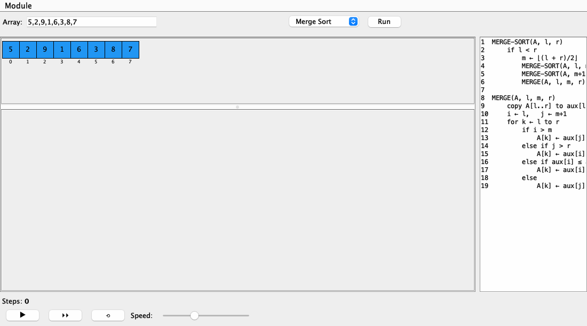
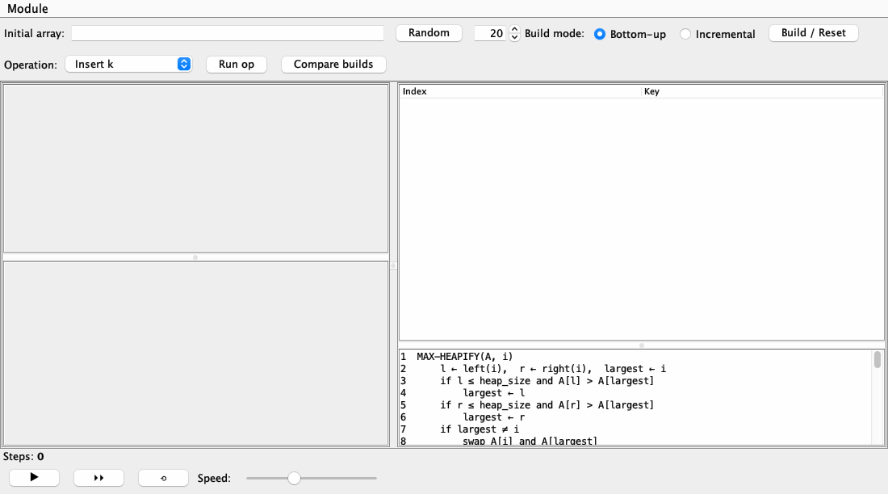

# AlgoStruct Studio

Watch search, sort and heap algorithms run one step at a time, with the pseudocode line they're on highlighted as they go.

 



AlgoStruct Studio is a small Java desktop app for learning how classic algorithms behave. Type an input and press Run: the algorithm plays like a video, with each comparison flashing and each swap shown the moment it happens. Pause whenever you like and step through it one change at a time, or rewind and watch the run again.

## What you can explore

**Arrays.** Linear search, binary search, insertion sort and merge sort. Searches tell you where the target is or that it isn't there. Binary search sorts the input first if it has to, and says so. Merge sort draws its recursion tree as it splits and merges, and each finished range turns green.

**Heaps.** Build a max-heap bottom-up or one insert at a time, then insert, extract the maximum, or raise and lower keys. The array, the tree and the index table always show the same heap. *Compare builds* runs both build methods on your input and reports how many comparisons and swaps each needed.



A step counter (comparisons plus writes) runs in both modules, so you can compare algorithms on the same input.

## Getting started

You need JDK 17 or newer and Maven.

```bash
git clone https://github.com/mert-ogul/AlgoStructStudio.git
cd AlgoStructStudio
mvn package
java -jar target/algostruct-studio.jar
```

## Controls

| Control | What it does |
| --- | --- |
| ▶ / ❚❚ | Play or pause |
| ▸▸ | Show the next change |
| ⟲ | Rewind; press ▶ to watch the run again |
| Speed | 0.05× to 4× |

Inputs are integers separated by commas or spaces. Switch between the Arrays and Heaps modules from the **Module** menu. In the searches, ticking **Index mode** makes the target a position in the array, and the value at that position is what gets searched for.

## How it works

Each algorithm runs in full as soon as you press Run, but nothing is drawn yet. Instead it queues small animation frames on a `Timeline`. When a frame plays, it posts events like "swap index 3 and 7" or "highlight line 8" on an `EventBus`, and the views redraw from those events. The algorithm never touches the screen itself, so pausing and replaying cost nothing extra.

```
src/main/java/edu/tue/dsvis/
  core/        Timeline, events, and the model/view/controller interfaces
  gui/         main window, playback bar, pseudocode pane, step counter
  modules/     the Arrays and Heaps modules
  widgets/     array strip, recursion tree, heap tree, heap table
src/main/resources/pseudocode/    the pseudocode shown next to each algorithm
```

To add an algorithm to the Arrays module, extend `Model` and queue your frames in `run()`, register it in `ArraysController.registerModels()`, and add its pseudocode file to the `algoToCode` map in `ArraysView`.

## License

MIT. See [LICENSE](LICENSE).
